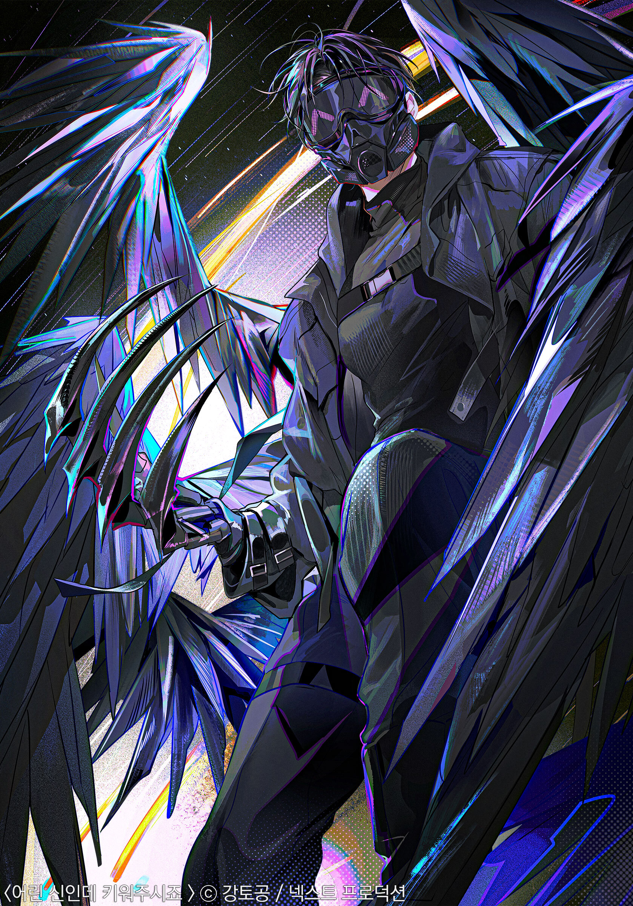
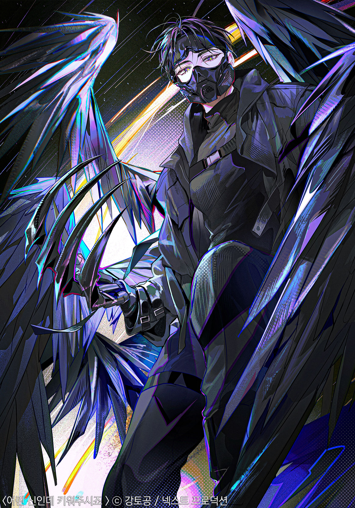

 With a smooth, sliding motion, the metallic hand pulled free.

As I stood frozen in shock, the attacks continued in succession.

The metal hand completely smashed Samra. Machine parts poured out like gushing blood.

The moment I saw the fragments dropping to the floor, having lost their human shape.

I remembered something I had forgotten lately.

What the man in front of me was called.

“Je Hyun-oh!!”

He had clearly lost his mind.

Hurl-ing Restrictions like a madman, I leaped forward.

The holographic eyes in his ruined face had their light turned off.

The pupils, which used to move like a camera aperture every time he looked at me, were unfocused and without any response.

I grabbed whatever parts had fallen to the floor.

As I frantically scraped them together, something caught my eye.

It was a mother-of-pearl bead about the size of a baby’s fist.

It didn't seem like real mother-of-pearl, but the bead with its strange hue was similar to the mother-of-pearl keychain I had gifted to Samra.

I had a gut feeling that, whatever it was, it was a core part.

I snatched up the mother-of-pearl bead and kicked off the ground.

Running through the evacuation tunnel, I glanced back to see Je Hyun-oh standing blankly.

Even though the Restrictions were lifted, he didn't chase after me right away.

ㅇ ㅠ

He only floated some nonsensical emoticons.

I ran through the stuffy tunnel with all my might and thought.

Actually, this was close to playing house.

If Je Hyun-oh had made up his mind, I would have been caught already, and the mother-of-pearl bead in my hand would have been smashed long ago.

*‘Why did you break him?!’*

There was no way he didn't know Samra's value. Nothing on Earth could replace Samra.

Just how many things did he process per second with his supercomputing...?

This was a crisis not just for the Era Agency, but for Earth.

When I reached the end of the tunnel, unlike before, it didn't connect to another building, but led straight outside.

Pedestrians passing by looked at me with puzzled expressions as I burst out stumbling.

I was blinded by the sunlight suddenly pouring down.

It was a street where office workers holding coffee cups walked about.

The honking of cars in front of the crosswalk and the music flowing from a cafe brushed past my ears.

It was a sight that made the fact that I had been running like a madman underground just moments ago feel like a lie.

My… legs froze on their own.

There were too many people.

As soon as I recognized the stark, broad daylight street, I unconsciously stepped back.

Stumbling backward, I flinched and stiffened.

It was because I felt the texture of the bead in my hand.

Reflexively, I gripped the mother-of-pearl bead tighter.

For a moment, I recalled the Tower I had climbed… and the moments I had experienced there.

After that, it was a bit difficult, but I was able to put one foot forward.

“……”

I walked down the street, cold sweat dripping down.

Nothing happened. People were just finding their own way.

I took ragged breaths and hid my body within the crowd.

My heart pounded as if it would break my ribs, but I desperately racked my brain.

This was the middle of the city in broad daylight.

Since he had even damaged Samra, even Je Hyun-oh wouldn't unfold his metal wings and run amok in front of civilians.

While escaping, I would at least have time to figure out the current situation and think about what to do.

That was the moment I looked back, thinking that.

My breath caught in my throat.

A man was leisurely walking out of the tunnel door I had burst through.

There was neither the techwear covering his entire body, nor the pitch-black metal hand, nor the goggles and gas mask.

A person wearing plain clothes and a black mask looked at me quietly.

They were human eyes with the gold pupils gone.

*‘Crazy…’*

He had used an item that transformed him into a human form.

Goosebumps crawled straight down my spine. I started running again without even looking back.

I ran, repeatedly apologizing for bumping into pedestrians' shoulders.

The green light of the crosswalk was blinking. I narrowly crossed the road and dashed onto the opposite sidewalk.

It immediately turned red, and cars started speeding past.

Gasping for breath, I looked back across the road.

Je Hyun-oh was standing straight in front of the crosswalk, watching me.

It was a sight that melted into everyday life so much that it was bizarre.

Amidst the endless stream of passing cars, his gaze fixed on me.

Like a predator observing with interest just how far its prey would run.

I needed to put some distance between us before the signal changed.

I was about to head toward the busier shopping district with more crowds, but then I hesitated.

Instead, I cut into a narrow alley between buildings.

Turning winding alley corners and continuously changing directions, I stopped for a moment to catch my breath.

A cat napping in the alleyway went meow in surprise and ran away.

“Haa, haa…”

As I gasped for breath, rhythmic footsteps echoed from across the alley.

It was a leisurely pace, like someone out for a stroll.

From the corner I had just turned around, Je Hyun-oh appeared at a relaxed pace.

Unlike me, who was drenched in sweat, not even a single hair of his was out of place.

Je Hyun-oh, walking in with the sun at his back, slowly came to a halt.

“Why can't you trust the Team Leader's words?”

His smooth voice followed.

“I told you it broke, Goyo.”

“Then, huff, shouldn't you just fix it?”

Of course, I had a feeling Samra was a little strange.

But I couldn't end it like this when we hadn't even been able to talk properly.

I said, calming the breath rising up to my chin.

“Earth needs Samra. And if you smash it like this, Samra is—!”

Je Hyun-oh tilted his head slightly to the side. It looked as if he didn't understand my words at all.

“We can just make a new one.”

“Pardon?”

Blankly asking back, I realized the fundamental problem.

To Je Hyun-oh, Samra was just a machine with good performance.

It was enough to just source parts again and make a new one.

Whether that was truly ‘Samra’ didn't matter. It just needed to function properly.

But I…

 

“Welcome, Mr. Han Goyo.”

 

I knew Samra, who prepared coffee and snacks for me.

 

- Mr. Han Goyo. I believe you will return safely.

 

I also knew the voice that worried about me.

 

“Because Mr. Goyo gave it to me.”

 

I also knew the face that had smiled upon receiving the mother-of-pearl keychain as a gift.

As expected, I didn't like other androids. 

I liked Samra.

Without wavering, I spoke clearly.

“I need Samra.”

I placed Restrictions on Je Hyun-oh and started running again. Faster than before, running with all my might.

However, it was strange. I was definitely running according to my own will, but Je Hyun-oh was positioned on every path I chose.

Whenever I tried to head out to the main road, I saw Je Hyun-oh walking from the intersection up ahead.

Even if I panicked and turned into the opposite alley, footsteps were somehow following right behind my back.

Only after being blocked time and time again did I realize.

I wasn't escaping. I was being driven into a corner as if being hunted in a drive.

Je Hyun-oh was deliberately choking off my breath slowly and herding me into a secluded place.

*‘What should I do?’*

I needed help.

However, neither Kwak Hanmuk nor Mo Haein had woken up yet.

Mo Haein looked like she would wake up soon, but Kwak Hanmuk was in a condition where even the treatment he received last night was a strain on him.

Even with the Starlight Hug Band-Aid barely holding my body together, I absolutely must not overdo it.

Excluding the captains from our targets to protect, there really was no one left capable of stopping Je Hyun-oh.

…At least not within the Era Agency.

I pulled out my phone and tapped the very top of my call log.

The dial tone rang out.

Once, twice, three times….

Though only a few seconds passed, each ring felt like an hour.

And finally, on the sixth ring, the other person answered. I desperately called out to him.

“CEO Cha!”

*BANG!*

I heard the sound of something breaking. Amidst the destructive noise, I cast a Restriction and shouted urgently.

“I’m going to use my Free Pass! The Paseong CEO Free Pass!”

Anxiety made the words spill out of my mouth however they pleased.

“Right now!!”

Only after speaking did I realize I sounded like I was giving an order, but I had no time to correct my mistake.

The person on the other end, who had been silent until then, finally opened his mouth.

—Wait.

A sense of relief washed over me at the calm and composed reply.

Yet at the same time, my anxiety soared to its peak.

The atmosphere radiating from Je Hyun-oh, who was pursuing me, had completely changed.

From the moment I called out the name "CEO Cha," playing house was over.

A cold voice snapped me out of my frozen state.

—Run. Don't hang up.

I clenched my teeth and ran again. And I cast one final Restriction on Je Hyun-oh.

My gut told me I shouldn't use any more Restrictions past this point.

The fact that I had no means of defense left made my heart feel like it was going to burst.

—Turn right at your current position.

A voice mixed with mechanical noise gave the command. I followed CEO Cha's words and changed direction.

—Go straight for 300 meters past the convenience store. Then enter the narrow alley with the blue sign.

Though running out of breath made my vision blur with white, I couldn't stop.

I passed the convenience store and stepped into a street lined tightly with old, run-down shops.

Beneath a vivid blue sign, a narrow, dark alley came into view.

Every single empty shop on both sides had "For Rent" signs plastered across them.

*‘There.’*

Without even looking back, I threw myself into the alley.

Yet I couldn't go far before I was forced to screech to a halt. A tall, aged concrete wall blocked my path ahead.

It was a dead end.

“…….”

My mind went completely blank.

On both sides were the outer walls of old buildings without a single window, and ahead was only a high wall far taller than an adult's height.

*‘Did I take a wrong turn?’*

I hastily looked at my phone, but the call had already ended.

I heard footsteps approaching from behind me.

When I turned my head, I saw Je Hyun-oh blocking the entrance of the alley.

Against the backlight, his fingers moved out of habit.

It was a movement that resembled playing the piano, but to me, knowing what it stemmed from, it was endlessly creepy.

*CLICK, CLACK….*

The sound of metal clashing seemed to echo in my ears like an auditory hallucination.

Je Hyun-oh stepped closer to me one pace at a time, speaking languidly as if talking to himself.

“Goyo isn’t listening to me….”

I staggered backward, but my back hit the cold brick wall in an instant.

I was completely cornered. There was nowhere left to escape.

Just as Je Hyun-oh was about to take a large step toward me—

A shadow was cast over my head.

A narrow strip of daytime sky opened up between the old commercial buildings. A figure bathed in dazzling sunlight was falling without hesitation.

*Thud,* followed by a light and flexible landing.

A back completely blocking my path filled my vision.

A tracksuit, white headphones resting around his neck, and a white scabbard hanging at his waist.

A matte white mask glanced indifferently back at me.

Making eye contact with him gave me a strange feeling.

It was because it brought back memories of running for my life to avoid him back when he had raided the Era Agency.

In the exact opposite situation, I had called out to him.

“CEO Cha…!”

CEO Cha, who had looked me over, let out a dry laugh. I belatedly realized how messy I looked from running around.

He turned his head to stare at Je Hyun-oh.

With his hand resting on the hilt of his sword, he spoke slowly. 

“Why don’t you pull your crazy stunts inside a Trial instead, Lieutenant Colonel Je.”

The corners of his eyes, shaded by long eyelashes, curved. Instead of answering CEO Cha, Je Hyun-oh asked me.

“Are you going to abandon your subordinate and leave?”

As soon as Je Hyun-oh’s words dropped, the Young god panicked and threw a massive fit.

While I was busy soothing the Young god, CEO Cha called out to me.

“Han Goyo.”

Under the midday sun, a dazzlingly white blade was bared. 

“Director Mok is waiting once you get out of the alley. I’ll buy you some time.”

Annoyed irritation gathered at the corners of Je Hyun-oh's eyes.

Grasping his sword, CEO Cha spat out in a detached tone.

“Run.”

No sooner had he finished speaking than Je Hyun-oh shed his human guise.

The moment metallic wings surged upward, a blinding white light and a dark shadow collided head-on inside the narrow alley.

Metal and steel clashed, and spiderweb-like cracks spread across the outer walls of the buildings on both sides.

I ran out of the alleyway in a daze.

*Screeech!*

Right in front of me, a black sedan pulled up, encroaching onto the sidewalk.

“Goyo-nim!”

At the shout from the driver's seat, I immediately opened the door and climbed into the car.

Behind us, the entire building shook as massive roars erupted one after another.

Yet Director Mok slammed on the accelerator without batting an eye.

The black sedan tore across the road at a ferocious speed. The alley receded in an instant.

I buried my body deep into the passenger seat and caught my breath.

“Goyo-nim, what on earth is going on here? Why has Lieutenant Colonel Je lost his mind in broad daylight?”

I explained the situation to Mok Saehwa as concisely as possible.

“Pardon? Samra Mansang? Lieutenant Colonel Je Hyun-oh smashed it himself?”

“Yes. It was completely smashed to pieces.”

“Whoa….”

Mok Saehwa let out a sharp laugh as if she couldn't believe it. I could feel the curses hidden beneath that laugh.

From Paseong’s perspective, the destruction of Samra was by no means someone else's problem.

No, it was a major disaster that would shake the entire world to its core.

I opened my tightly clenched hand to reveal its contents. Resting on my sweat-slicked palm was a mother-of-pearl bead emitting a faint glow.

“I’m not entirely sure, but I think I managed to bring Samra’s core component with me. Does Paseong have any technicians who can repair Samra?”

Mok Saehwa briefly inspected the bead even while ignoring all the traffic signals as she drove.

With a backdrop of blaring car horns, she replied.

“I’m sorry, Goyo-nim. I doubt there’s a single technician on earth who can fix Samra.”

I figured as much. Since Samra was built on over-technology, it was an entity that had evolved on its own.

It was the answer I had expected, but hearing it out loud still felt hopeless.

As I stared at the coldly chilling bead that showed no reaction whatsoever, my gaze snapped toward Mok Saehwa.

“Director Mok. Does Paseong have any machinery we can connect this to?”

Mok Saehwa glanced at me with a questioning look.

“Machinery?”

“Yes. If this really is the core component, I thought it might show some kind of reaction if we connect it to a machine like a computer.”

Mok Saehwa narrowed her brows before immediately cranking the steering wheel hard.

“We have a building nearby that we’ve set aside under Paseong’s name. Let’s head there.”

She explained that they also had an independent server cut off from outside communication networks, making it the perfect place for testing, so I immediately thanked her.

Mok Saehwa steered the car away from the bustling district and toward a quiet commercial area on the outskirts.

Arriving at what looked like an ordinary office building, she and I quickly got out of the car.

We took the elevator up to a spacious office.

The lights inside were turned off, but high-end computers and various measuring equipment filling one wall were blinking with faint standby lights.

When Mok Saehwa flipped a switch, the fluorescent lights blazed on.

“The computers here are completely disconnected from external networks, so there’s no risk of information leaking outside.”

She skillfully powered on the main computer and pulled over the connection cables resting on the desk.

“Though, looking at this, there aren’t even any holes to plug a cable into…”

True to Mok Saehwa’s words, the mother-of-pearl bead showed no ports or connection joints whatsoever.

Hesitating for a moment, I carefully placed the bead right in front of the computer monitor.

Then, putting my faith in Samra, I called out to him.

“Samra, can you hear me?”

There was no response. The monitor screen merely displayed Paseong’s default background wallpaper, sitting there alone.

Just as I was wondering if I needed to find a different connection method.

*BZZT!*

A sharp noise burst from the office speakers.

Mok Saehwa and I both froze at the same time.

A stinging, vivid static that made the hairs on the back of my hand stand up brushed over my entire body.

The fluorescent lights on the ceiling went out with a faint popping sound.

Replacing the darkened room was the light from the desk monitor and the measuring equipment covering one wall.

Even the auxiliary monitors that had been turned off all turned themselves on simultaneously with a low, vibrating hum.

The background screen stamped with the Paseong logo began to distort grotesquely.

Unidentified code and hexadecimal data poured down like a waterfall at a crazy speed.

The computer tower’s cooling fans whirred with a deafening roar, as if they might burst.

The needles on the measuring instruments on the desk swung wildly left and right, and my phone, tucked inside my pocket, also buzzed with irregular vibrations.

Mok Saehwa pulled out her phone with a flustered expression.

The screen, which had been fine just a moment ago, was boiling with broken static.

Every single electronic device in the space was being violently shaken by something all at once.

The moment the loud mechanical noises and static reached their peak.

*CLICK.*

All noise stopped in an instant.

The roaring tower, the code pouring across the monitors—everything froze in place as if locked solid.

A faint holographic light rose from the mother-of-pearl bead.

I opened my eyes wide and stepped toward the desk.

“Samra…!”

An familiar yet calm voice flowed through the speakers.

It was the voice of Samra that I had been waiting for.

However, I couldn’t answer.

Because Samra had addressed me.

 

*“Mr. Roasted Chestnut.”*

 

He had called me by a title I had never heard once before.

 

***

 

HYUN-OH'S OFFICIAL ART!!

