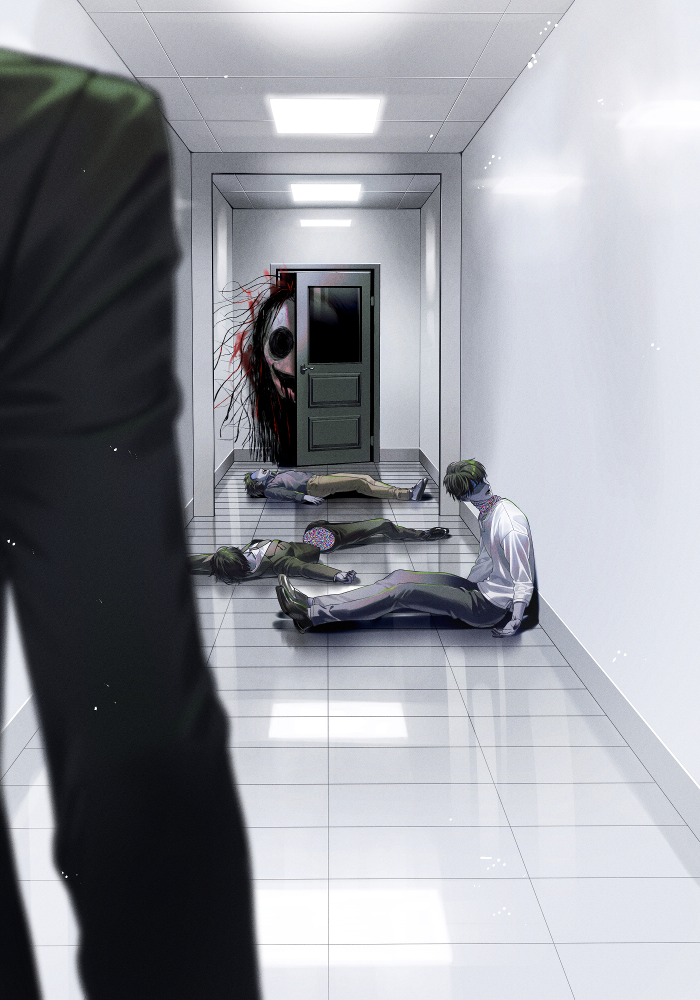

 “Damn it.”

Inside the elevator, I clenched and unclenched my fists.

Regression.

An ability that appeared in countless works of fiction.

Remaining Regression attempts.

 

  [Remaining Regressions: ?? times]

 

My ability was Regression.

And with an unknown number of Remaining Regressions, I had to make my way through this place.

What was more, I had just died.

“…”

I rubbed my neck.

There had definitely been the sound of something snapping near the back of my neck.

“…”

Cold sweat ran down my skin.

I had died in the blink of an eye.

Slowly, I turned my gaze forward.

An empty corridor.

So this was what it meant by the view from inside the elevator being different from the view from the outside.

Still, there hadn't been anything written about a pool of blood.

Shouldn't someone have written that down?

With that thought, I flipped through the notebook again, but there wasn't a single mention of a pool of blood gathered on the floor.

“…”

*Could it be…?*

Just in case, I read through it again and noticed a curiously redacted section.

[91. Why is no one talking about the ■■■■? I thought I was gonna die.] 
[92. I think someone is intentionally erasing it.] 
[93. Then does that mean we're being watched right now?] 
[94. Going by the three opinions above, does that mean someone has to be monitoring us?] 
[95. To be precise, it doesn't seem like censorship so much as certain information being deliberately blocked. Looks like we need a way around it?]

“…”

Censorship of information.

I understood what it meant.

If I assumed ■■■■ meant "pool of blood," everything clicked into place.

It was obvious considering the words blocked out by black squares in the first place.

You could write everything in the notebook, but the notebook didn't show everything.

Ultimately, it meant some degree of censorship existed.

For now, just to be safe, I should write it down again.

Right now, it was filled up to number 149, so…

“…”

I was number 150.

As for a pen…

As if reading my thoughts, *tap*, a pen dropped from the notebook.

Picking up the pen, I slowly began to write.

[150. Watch the floor]

“…”

After writing, I examined the notebook closely, but nothing happened.

It seemed it didn't get censored immediately.

“All right.”

Setting the notebook down, I stood up straight.

It did say staying in the elevator too long wasn't good either.

Stepping out of the elevator, I cautiously moved forward.

At the exact same time, the scenery shifted once more.

A squelching floor, and—

*This time, let's watch out for the puddles.*

I exited the elevator.

The flickering lights of the corridor were still waiting for me.

The lights flashed on the moment I stepped outside.

Though it was hard to see well in the dimness, there were dark red pools of blood and skid marks.

Clutching the notebook in one hand, I moved ahead.

Holding my breath when the lights came on, taking steps again when the lights went out—how many times had I repeated that?

A corridor branching in two directions appeared.

It said to go left from here.

Looking to the left, I spotted a door at the end of the hall.

“…”

Slowly advancing, I barely managed to reach the door.

When I gently pulled it, the door swung open with a creak.

A bright light stung my eyes.

“Ugh.”

Frowning, I looked forward, and a brightly lit room was waiting for me—as if the path I had walked just moments ago were a complete lie.

There was nothing special about the room.

A single plastic chair, a dining table that looked straight out of a convenience store, and…

“…”

A mascot was standing there.

It was a bear mascot.

A round, gentle-looking bear mask over a mascot suit.

In contrast to the suit, which was covered in grime, the bear mask was quite clean.

“…!”

The moment it saw me, the bear mascot waved its hands with delight.

The atmosphere was a little—no, vastly different from anywhere I had passed through so far.

“W-Wait…!”

Then, before I could say anything, it came up behind me and began massaging my shoulders.

“Wait!”

When I shouted in a hurry, the mascot pulled its hands away and threw them up as if startled.

“…Is, is this…”

As if listening closely to my words, the mascot cupped a hand to its ear.

“The halfway room?”

“…!”

At my question, the mascot nodded vigorously.

Then it gave me a thumbs-up as if to praise me for a job well done.

“F-Finally.”

“…!!”

“Finally…!”

I had reached the halfway point for the first time.

Letting out a cheer of joy, I looked at the mascot, and it kept giving me a thumbs-up before wrapping me in a hug and jumping up and down with me.

Just as written in the notebook, it didn't seem to be a mascot that posed much harm to humans.

Of course, that didn't mean I could trust it completely, but…

Still, compared to the bastard that had snapped my neck the second I was spotted, seeing this guy gave me some peace of mind.

After savoring the joy for a moment, I looked at the mascot, who was clapping enthusiastically.

“Excuse me.”

“?”

The mascot tilted its head at my voice.

“How many people have come here?”

“…”

The mascot counted on its fingers back and forth before shaking its head.

“You don't know?”

“!”

The mascot nodded.

“…”

It didn't know.

Including me, 150 people had arrived.

Whether it hadn't counted or couldn't count, I couldn't tell, but…

“…”

There was no need to tell it about the notebook.

After slipping the notebook into my pocket, I looked over at the table.

A cucumber mayonnaise sandwich and tomato juice.

And the mascot was holding that food, repeatedly thrusting it toward me.

“Is this for me to eat?”

The mascot nodded vigorously at my question.

“…”

If it told me to eat, I had to eat.

It would be bad if I refused and the thing ended up pouting or getting upset.

Slowly stuffing the food into my mouth, I looked around.

Just the mascot, and a small chair and desk.

Was there really nothing special?

The notebook did say there were no notable details worth referencing.

Well, of course, there were some notable things, but still.

I turned my gaze to the mascot.

An NPC.

According to the notebook, it was an NPC…

I observed the mascot closely, but without uttering a single word, it merely stood with its hands clasped together, looking at me.

“Do you know how to get out of here?”

“?”

“A hint.”

“??”

“An escape route.”

“???”

“A secret.”

“????”

“A hidden piece.”

“?????”

No matter what I asked, the mascot simply tilted its head and stared back at me.

Yeah, it was my fault for asking.

Letting out a deep sigh, I looked away toward the exit.

If I passed through here, an exit should appear.

If I just got through here, I could go home…

“…”

A horrifying thought suddenly struck me.

What if it wasn't home?

If I escaped this place and yet another place appeared, what was I supposed to do?

No, now wasn't the time for thoughts like that.

I slapped both cheeks with a loud *smack* and turned my gaze elsewhere.

Right now, my only choice was to move forward.

Facing the mascot, which was still spacing out, I opened the notebook.

Before heading out, let's review the information once more.

First, this time it was the opposite—I had to move when the lights were on.

This was actually good news.

Before this, the dark had made it such a struggle to get through.

Though the rule about not making any sound still applied.

“…”

However, there is one thing that bothers me.

[19. Found the exit. The way out is to move quietly, shake off the monster, and press the elevator button quickly.

Never ■■■■■■.]

[22. Found the exit.
Walk only when the lights are on. Don't chicken out. But don't be too brave either.

Expect to lose at least an arm.

■■■■■■]

[I will leave information for the next floor as well. I pray that you meet me alive.

Lastly, never ■■■■■■.]

■■■■■■.

The thing everyone is warning about.

I have no idea what the hell this is.

Did they all consistently see the same thing?

And...

"..."

At some point, everyone already knows.

That certain information gets censored.

Even so, why did they all write down the same information?

Especially knowing it would get censored.

Either it is information that important, or else...

"..."

I press firmly on my temples.

No matter how much my ability is Regression, I don't take dying lightly.

Besides, thinking about how I'll start over at the elevator when I die is utterly terrifying.

For now, leaving ■■■■■■ aside, let's recall the remaining parts I need to be careful about.

I quickly begin to review.

There are two major ones.

First. Move when the lights are on.
Second. Trust your instincts.

"..."

Good.

I turn my gaze back to the mascot suit.

"I'll be going now."

"...!"

The mascot suit gives me a thumbs-up again.

As if telling me to have a safe trip.

Even so, maybe because it's a mascot suit, it feels a bit unsettling.

After giving an awkward farewell, I turn my gaze back outside.

I take a slow step forward.

I open the door, the door opening with a creak.

It was a clean hallway, completely different from usual.

It was so bright and clean that it felt bizarrely different from the hallway I had just walked through.

The only way to confirm that this place was still out of its mind was...

"..."

Torn pieces of clothing were scattered in every corner.

There wasn't a single drop of blood, nor a single corpse.

Just a clean hallway illuminated by fluorescent lights, and torn clothing as the only remaining trace.

I slowly take a step.

As I step outside, the fluorescent light begins to flicker precariously.

Meaning I should be careful since it might go out at any moment.

Thinking that, I slowly take a step forward.

Making not a single sound of footsteps...

And soon, the lights go out, and I hold my breath.

Let's not make a single sound.

And let's trust my instincts.

Though I have no idea what my instincts actually are.

How long had I been holding my breath like that?

The lights turn on again, and I resume walking.

Easy. At this rate, I'll be able to get out in no time.

At that moment,

"...!"

I felt a chilling sensation.

I couldn't explain it with words, but it felt like a giant something was grabbing my heart.

The feeling of a human hiding behind a tree while being chased by a beast.

Was this what it meant to follow your instincts?

I cover my mouth and stop breathing.

How long had I been holding my breath?

The sensation vanishes, and I begin to walk again.

How far had I walked?

"...!"

I see the elevator right in front of me.

The elevator with its doors open, open as if tempting me.

Just in case, I looked around my surroundings, but no other exit besides the elevator was visible.

That means...

It's the exit.

I begin to quicken my pace little by little.

I need to get out of here first.

If I get out, what should I do?

Should I call the police first?

What am I supposed to call and say?

That I rode a crazy elevator and got kidnapped to some bizarre place?

While I was walking and having thoughts like that,

*Rustle!*

Some sound comes from behind.

Cold sweat instantly broke out.

What is it?

Is something there?

I hurriedly turn my head,

And saw what I hadn't seen before.

"...!"

I quickly pull my body back.

I turn my gaze back toward the elevator.

It's not far.

Should I run?

Or should I walk?

Is the probability of reaching this place high if I run? Or is it better to follow the rules?

Hesitation crossed my mind for a split second, but the conclusion was fast.

Let's walk.

If the notebook tells you not to do it, there must be a reason.

My heart feels like it's going to pop right out of my throat, but there has to be a rea—

"Please save me."

"...!"

Cold sweat pours down.

There's a person here?

For a split second, I almost turned my body around to look back, but,

"..."

I start walking straight ahead without saying a single word.

At least, as far as I knew, if there were a person here, someone would have already shouted.

It's definitely an auditory hallucination.

And I had no intention of ignoring the alarm bell ringing in my head instinctively, either.

Walking that slowly, I finally arrived inside the elevator.

It was an elevator with nothing particularly special about it.

Glancing back and forth quickly, I carefully press the button.

With a clunk, the doors close,

"...Phew."

I let out a sigh of relief.

I made it out well.

Thinking that, I turn my body around,

And made eye contact with that thing standing behind me before I even realized it.

The door that hadn't closed.

Only a head was floating aimlessly in mid-air.

The place where eyes should have been was also hollowed out, and letting out an unknown pitch-black liquid from its mouth, it opens its mouth once more.

"Ding..."

The exact same sound as the elevator chime.

"...What the h—"

The moment I hurriedly reached out my hand to press the button,

"...Huh?"

My body sinks straight down to the floor.

My feet won't move.

Why?

I turn my gaze,

And down there, only a pair of pants were fluttering as they collapsed onto the floor.

"Wh—?"

Before I could react to anything,

"Please save me."

It lowers its head toward me and speaks,

"Ghk—!"

The sensation of something gigantic crushing my head overwhelms me.

Wouldn't this feel similar to placing a human head under a hydraulic press and pushing the button?

"Please save me."

"Ah, ugh...!"

"Please save me."

"..."

"Please save me."

And right in front of me, unable to even let out a scream, it was shaking its head and saying those words,

Only after pain so intense that I couldn't even scream persisted for a long time,

With a *snap*, my consciousness finally cut off.

* * *

"Aack!"

I hurriedly sit my body up, and a bright light greets me.

I regressed.

As I quickly turn my gaze, the familiar white wall and the mascot suit looking down at me...

"...!"

The mascot suit helping me up and gesturing wildly with its hands and feet.

The mascot suit?

As I sit up and look around my surroundings, a plastic chair, a desk, and the mascot suit holding a plastic bag and looking at me catch my eye.

I place a hand over my chest area.

My heart was still beating at a crazy, rapid speed.

I'm alive.

No, I'm back.

Ignoring the gaze of the mascot suit looking down at me, I unfold the notebook again.

■■■■■■.

What kind of thing is it?

Aside from what everyone commonly writes, what else can I deduce?

"..."

Before figuring out my own actions, let's think about why the others wrote it this way.

At least those who read this notebook know that if they write hints too directly, several of them get censored.

Even so, those people wrote the exact same text.

Why?

"..."

The highest probability is that they were in a rush.

That they were in too much of a rush and didn't have time to write anything else.

Just what could have happened to make them...

"..."

I think back on my own actions.

And the reason they had no choice but to write in such a rush.

It was probably because it was the end.

The reason they had no choice but to hurriedly scribble in the notebook and escape.

"...I've got it."

Looking at the mascot suit tilting its head, I nodded.

"I figured it out."

What ■■■■■■ means.

 

<small>
Illustrator: Ninto The illustrations for this content were produced with support from the Publication Industry Promotion Agency of Korea.</small>

